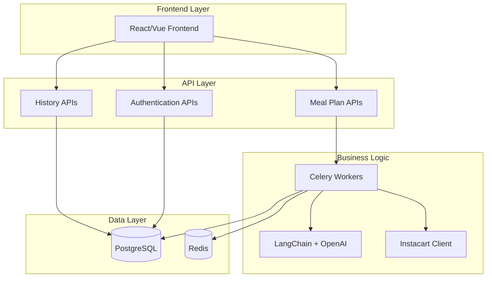
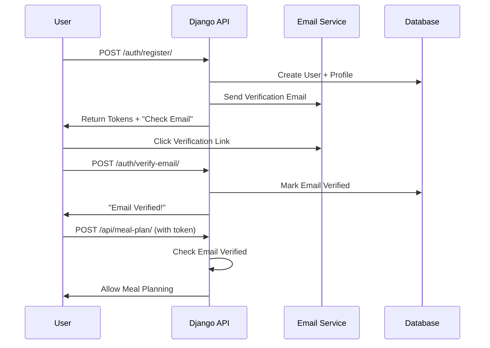

# 🍽️ Django Meal Planning Project

A comprehensive Django-based meal planning system that uses AI to generate personalized weekly meal plans with automatic shopping cart creation. Features secure authentication, email verification, meal plan history tracking, and seamless Instacart integration.

## ✨ Key Features

- 🤖 **AI-Powered Meal Planning**: Uses OpenAI GPT models via LangChain for intelligent meal suggestions
- 🛒 **Automatic Shopping Carts**: Generates Instacart shopping carts from meal plans
- 🔐 **Secure Authentication**: JWT tokens with email verification for premium features
- 📚 **Meal Plan History**: Complete history tracking with user ratings and notes
- 🎯 **User Preferences**: Dietary restrictions, budget constraints, and preference matching
- 🐳 **Docker Ready**: Complete containerized development environment
- 📊 **Admin Dashboard**: Rich Django admin interface with formatted JSON displays
- 🧪 **Comprehensive Testing**: Full test suite with authentication flow coverage

## 🚀 Quick Start

### Prerequisites
- Docker and Docker Compose (recommended)
- OR Python 3.11+, PostgreSQL, Redis (for local development)

### Option 1: Docker (Recommended)

The easiest way to get started is using Docker, which ensures a consistent environment across all machines:

```bash
# Clone the repository
git clone <your-repo-url>
cd django-project

# Start the development environment
make dev-up

# Create a superuser (optional)
make superuser
```

**Access the application:**
- 🌐 **Django API**: http://localhost:8000
- 👑 **Django Admin**: http://localhost:8000/admin/
- 🐘 **pgAdmin (PostgreSQL)**: http://localhost:8080 (admin@admin.com / admin)
- 🔴 **Redis Commander**: http://localhost:8081

### Option 2: Local Development

If you prefer to run locally without Docker:

```bash
# Create virtual environment
python3.11 -m venv venv
source venv/bin/activate

# Install dependencies
pip install -r requirements.txt

# Set up environment variables
cp .env.example .env
# Edit .env with your API keys

# Start services
brew services start redis
brew services start postgresql

# Run migrations
python manage.py migrate

# Start Celery worker (new terminal)
celery -A core worker --loglevel=info

# Start Django server
python manage.py runserver
```

## 🏗️ System Architecture



### Core Components

- **Django REST API**: Authentication, meal planning, history management
- **LangChain + OpenAI**: AI meal plan generation with GPT-4
- **Celery + Redis**: Asynchronous task processing
- **PostgreSQL**: User data, profiles, meal plans, and history
- **Instacart API**: Shopping cart creation and management
- **Email System**: User verification and notifications

## 🔐 Authentication System

### Security Features
- ✅ **Secure Password Hashing**: PBKDF2-SHA256 with 1M iterations + unique salts
- ✅ **Email Verification**: Required for meal planning features
- ✅ **Rate Limiting**: Protection against brute force attacks
- ✅ **JWT Tokens**: Access and refresh token system
- ✅ **User Isolation**: Users can only access their own data

### Authentication Flow



## 📡 API Documentation

### Authentication Endpoints

#### Register User
```bash
POST /auth/register/
Content-Type: application/json

{
  "username": "johndoe",
  "email": "john@example.com", 
  "password": "SecurePassword123!"
}
```

**Response:**
```json
{
  "access_token": "your-access-token",
  "refresh_token": "your-refresh-token",
  "user": {
    "id": 1,
    "username": "johndoe",
    "email": "john@example.com"
  },
  "email_verification_sent": true,
  "message": "Registration successful! Please check your email to verify your account."
}
```

#### Login User
```bash
POST /auth/login/
Content-Type: application/json

{
  "username": "johndoe",
  "password": "SecurePassword123!"
}
```

#### Verify Email
```bash
POST /auth/verify-email/
Content-Type: application/json

{
  "token": "verification-token-from-email"
}
```

#### Other Auth Endpoints
- `POST /auth/logout/` - Logout user
- `POST /auth/refresh/` - Refresh access token
- `POST /auth/resend-verification/` - Resend verification email

### Profile Management

#### Get User Profile
```bash
GET /auth/profile/
Authorization: Token your-access-token
```

**Response includes current meal plan:**
```json
{
  "id": 1,
  "username": "johndoe",
  "email": "john@example.com",
  "profile": {
    "preferences": ["quick_meals", "healthy"],
    "dietary_restrictions": ["no_nuts"],
    "weekly_budget": "75.00",
    "meal_plan": {
      "week_of": "2024-01-15",
      "total_budget": 75.0,
      "meals": [...],
      "shopping_list": [...],
      "nutritional_summary": {...}
    }
  }
}
```

#### Update Profile
```bash
PUT /auth/profile/update/
Authorization: Token your-access-token
Content-Type: application/json

{
  "preferences": ["vegetarian", "quick_meals"],
  "dietary_restrictions": ["no_dairy"],
  "weekly_budget": "100.00"
}
```

### Meal Planning (Requires Email Verification)

#### Generate New Meal Plan
```bash
POST /api/profiles/{profile_id}/trigger-meal-plan/
Authorization: Token your-access-token
```

**Response:**
```json
{
  "status": "success",
  "message": "Meal planning process initiated for profile ID: 1",
  "task_id": "celery-task-id"
}
```

#### Get Current Meal Plan
```bash
GET /api/meal-plan/
Authorization: Token your-access-token
```

**Response:**
```json
{
  "status": "success",
  "message": "Meal plan retrieved successfully",
  "meal_plan": {
    "week_of": "2024-01-15",
    "total_budget": 75.0,
    "meals": [
      {
        "day": "Monday",
        "breakfast": {
          "name": "Oatmeal with Berries",
          "ingredients": ["oats", "blueberries", "milk", "honey"],
          "prep_time": "5 minutes",
          "cost": 3.50
        },
        "lunch": {...},
        "dinner": {...}
      }
    ],
    "shopping_list": [
      {
        "item": "oats",
        "quantity": "1 container", 
        "estimated_cost": 3.99
      }
    ],
    "nutritional_summary": {
      "daily_avg_calories": 1850,
      "daily_avg_protein": 95,
      "daily_avg_carbs": 180,
      "daily_avg_fat": 65
    }
  }
}
```

### 📚 Meal Plan History (NEW!)

#### Get Meal Plan History
```bash
GET /api/meal-plan/history/
Authorization: Token your-access-token

# Optional query parameters:
# ?limit=10&offset=0&year=2024&month=1
```

**Response:**
```json
{
  "status": "success",
  "message": "Meal plan history retrieved successfully",
  "data": {
    "history": [
      {
        "id": 1,
        "week_start_date": "2024-01-15",
        "week_end_date": "2024-01-21",
        "year": 2024,
        "month": 1,
        "week_number": 3,
        "total_budget": 75.0,
        "meal_count": 21,
        "shopping_list_items": 15,
        "was_completed": true,
        "user_rating": 4,
        "notes": "Great variety! Loved the salmon dish.",
        "created_at": "2024-01-15T10:30:00Z",
        "archived_at": "2024-01-22T09:15:00Z"
      }
    ],
    "pagination": {
      "total_count": 5,
      "limit": 10,
      "offset": 0,
      "has_more": false
    }
  }
}
```

#### Get Historical Meal Plan Details
```bash
GET /api/meal-plan/history/{history_id}/
Authorization: Token your-access-token
```

**Returns complete meal plan data for the historical entry.**

#### Update Historical Meal Plan (Rate & Review)
```bash
PUT /api/meal-plan/history/{history_id}/update/
Authorization: Token your-access-token
Content-Type: application/json

{
  "was_completed": true,
  "user_rating": 4,
  "notes": "Great meals! The shopping took longer than expected but recipes were easy to follow."
}
```

#### Archive Current Meal Plan
```bash
POST /api/meal-plan/archive/
Authorization: Token your-access-token
```

**Manually archives current meal plan without generating a new one.**

## 🗄️ Database Schema

### Core Models

#### User & Profile
```python
User (Django built-in)
├── username, email, password (hashed)
└── Profile (1:1)
    ├── preferences (JSON)
    ├── dietary_restrictions (JSON) 
    ├── weekly_budget (Decimal)
    ├── meal_plan (JSON) - Current active plan
    └── location, bio, etc.
```

#### Meal Plan History (NEW!)
```python
MealPlanHistory
├── user (ForeignKey)
├── meal_plan_data (JSON) - Complete meal plan
├── week_start_date, week_end_date (Date)
├── year, month, week_number (Integer) - For easy querying
├── total_budget (Decimal)
├── was_completed (Boolean)
├── user_rating (Integer 1-5)
├── notes (Text)
└── created_at, archived_at (DateTime)
```

#### Authentication
```python
EmailVerification (1:1 with User)
├── verification_token (UUID)
├── is_verified (Boolean)
└── expires_at (DateTime)

RefreshToken (1:1 with User)
├── token (UUID)
├── expires_at (DateTime)
└── is_valid (Boolean)
```

### Database Views in pgAdmin

1. **Navigate to**: http://localhost:8080
2. **Login**: admin@admin.com / admin
3. **Key Tables**:
   - `auth_user` - User accounts
   - `users_profile` - User profiles with current meal plans
   - `users_mealplanhistory` - Historical meal plans ⭐ **NEW**
   - `users_emailverification` - Email verification status
   - `authtoken_token` - API tokens

## 🧪 Testing

### Automated Testing
```bash
# Run all tests
make test

# Run specific test suites
make test-auth          # Authentication flow
make test-components    # Component tests  
make test-integration   # End-to-end workflow
make test-instacart     # Instacart API
```

### Manual API Testing

#### Complete Authentication Flow
```bash
# 1. Register user
curl -X POST http://localhost:8000/auth/register/ \
  -H "Content-Type: application/json" \
  -d '{
    "username": "testuser",
    "email": "test@example.com",
    "password": "SecurePass123!"
  }'

# 2. Check verification status (should be false)
curl -X GET http://localhost:8000/api/email-verification-status/ \
  -H "Authorization: Token YOUR_ACCESS_TOKEN"

# 3. Get verification token from logs and verify
curl -X POST http://localhost:8000/auth/verify-email/ \
  -H "Content-Type: application/json" \
  -d '{"token": "VERIFICATION_TOKEN_FROM_LOGS"}'

# 4. Now you can create meal plans!
curl -X POST http://localhost:8000/api/profiles/1/trigger-meal-plan/ \
  -H "Authorization: Token YOUR_ACCESS_TOKEN"
```

#### Test Meal Plan History
```bash
# Get meal plan history
curl -X GET http://localhost:8000/api/meal-plan/history/ \
  -H "Authorization: Token YOUR_ACCESS_TOKEN"

# Rate a historical meal plan
curl -X PUT http://localhost:8000/api/meal-plan/history/1/update/ \
  -H "Authorization: Token YOUR_ACCESS_TOKEN" \
  -H "Content-Type: application/json" \
  -d '{
    "was_completed": true,
    "user_rating": 5,
    "notes": "Excellent meal plan! Will definitely use these recipes again."
  }'
```

## 🔧 Development Commands

### Docker Commands (Makefile)
```bash
make dev-up              # Start development environment
make dev-down            # Stop development environment  
make dev-logs            # View all service logs
make rebuild             # Rebuild and restart containers

# Database
make migrate             # Run Django migrations
make superuser           # Create Django superuser
make shell               # Open Django shell

# Database Viewing
make view-db             # Database summary
make view-users          # View all users
make view-profiles       # View user profiles  
make view-meal-plans     # View generated meal plans

# Testing
make test                # Run all tests
make test-auth           # Authentication tests
make test-components     # Component tests

# Logs
make logs-web            # Django logs
make logs-celery         # Celery worker logs
make logs-celery-beat    # Celery beat logs
```

### Django Management Commands
```bash
# Custom management command for data viewing
python manage.py view_data --summary        # Database overview
python manage.py view_data --users          # All users
python manage.py view_data --profiles       # User profiles
python manage.py view_data --meal-plans     # Meal plans with history
```

## 🔑 Environment Configuration

Create a `.env` file with these variables:

```env
# Django Core
DJANGO_SECRET_KEY=your-super-secret-key-here
DJANGO_DEBUG=True
DJANGO_ALLOWED_HOSTS=localhost,127.0.0.1,0.0.0.0

# Database (PostgreSQL for Docker, SQLite for local)
DATABASE_URL=postgresql://postgres:postgres@db:5432/meal_planning

# Redis
REDIS_URL=redis://redis:6379/0

# AI & External APIs
OPENAI_API_KEY=sk-your-openai-api-key
INSTACART_API_KEY=your-instacart-api-key
INSTACART_API_SECRET=your-instacart-secret

# Email Configuration (Production)
EMAIL_BACKEND=django.core.mail.backends.smtp.EmailBackend
EMAIL_HOST=smtp.gmail.com
EMAIL_PORT=587
EMAIL_USE_TLS=True
EMAIL_HOST_USER=your-email@gmail.com
EMAIL_HOST_PASSWORD=your-gmail-app-password
DEFAULT_FROM_EMAIL=noreply@yourdomain.com

# Frontend Integration
FRONTEND_URL=http://localhost:3000
CORS_ALLOWED_ORIGINS=http://localhost:3000,http://127.0.0.1:3000

# LangChain (Optional)
LANGCHAIN_TRACING_V2=true
LANGCHAIN_API_KEY=your-langchain-api-key
LANGCHAIN_PROJECT=meal-planner
```

### Email Setup

**Development**: Emails are printed to console by default.

**Production Gmail Setup**:
1. Enable 2-factor authentication on Gmail
2. Generate an "App Password" in Google Account settings
3. Use the app password as `EMAIL_HOST_PASSWORD`

## 📁 Project Structure

```
django-project/
├── 🔐 users/                   # Authentication & User Management
│   ├── models.py              # User, Profile, MealPlanHistory, EmailVerification
│   ├── views.py               # Auth endpoints with email verification  
│   ├── serializers.py         # API serializers
│   ├── admin.py               # Django admin with JSON formatting
│   └── management/commands/   # Custom management commands
│       └── view_data.py       # Database viewing utility
│
├── 🍽️ api/                     # Meal Planning API
│   ├── views.py               # Meal plan & history endpoints
│   └── urls.py                # API routing
│
├── ⚙️ core/                     # Django Core & Background Tasks
│   ├── settings.py            # Django settings + email config
│   ├── tasks.py               # Celery tasks with auto-archiving
│   ├── instacart_client.py    # Instacart API integration
│   ├── celery.py              # Celery configuration
│   └── urls.py                # Main URL routing
│
├── 🐳 Docker Configuration
│   ├── Dockerfile             # Django app container
│   ├── docker-compose.dev.yml # Development services
│   ├── docker-compose.yml     # Production services
│   └── scripts/               # Docker utility scripts
│       ├── docker-setup.sh    # Initial setup
│       └── docker-commands.sh # Service management
│
├── 🧪 Testing
│   ├── test_authentication.py # Auth flow testing
│   ├── test_components.py     # Component testing  
│   ├── test_integration.py    # End-to-end testing
│   ├── test_services.py       # Service connectivity
│   └── TESTING_GUIDE.md       # Testing documentation
│
├── 📊 Database & Utilities
│   ├── check_meal_plans.py    # Database inspection
│   ├── view_meal_plan.py      # Meal plan viewer
│   ├── cleanup_failed_plans.py # Cleanup utility
│   └── logs/                  # Application logs
│
├── 🔧 Configuration
│   ├── requirements.txt       # Python dependencies
│   ├── Makefile              # Development commands
│   ├── .env.example          # Environment template
│   └── README.md             # This file
└── 📚 Documentation
    ├── DOCKER_README.md       # Docker setup guide
    └── TESTING_GUIDE.md       # Testing instructions
```

## 🎯 Key Workflows

### New User Onboarding
1. **Register** → Get access/refresh tokens + verification email sent
2. **Verify Email** → Click link in email or use token via API
3. **Update Profile** → Set preferences, dietary restrictions, budget
4. **Generate Meal Plan** → AI creates personalized weekly plan
5. **Rate & Review** → Provide feedback on completed meal plans

### Weekly Meal Planning
1. **Auto-Archive** → Previous week's meal plan automatically saved to history
2. **Generate New** → AI creates fresh meal plan based on preferences
3. **Shop** → Use generated Instacart cart for easy shopping
4. **Track** → Mark as completed and rate the experience

### Data Management
1. **Current Plan** → Active meal plan in `Profile.meal_plan`
2. **History** → All previous plans in `MealPlanHistory` table
3. **Analytics** → User ratings, completion rates, budget tracking
4. **Admin Tools** → Django admin with formatted JSON displays

## 🐛 Troubleshooting

### Authentication Issues
```bash
# Check user verification status
make shell
>>> from django.contrib.auth.models import User
>>> user = User.objects.get(username='your-username')  
>>> print(f'Email verified: {user.profile.is_email_verified}')

# Manually verify user (for testing)
>>> from users.models import EmailVerification
>>> verification = EmailVerification.objects.get(user=user)
>>> verification.is_verified = True
>>> verification.save()
```

### Meal Plan Issues
```bash
# Check meal plan history
curl -X GET http://localhost:8000/api/meal-plan/history/ \
  -H "Authorization: Token YOUR_TOKEN"

# View database contents
make view-meal-plans

# Check Celery logs
make logs-celery
```

### Service Issues
```bash
# Check all services
make status

# View logs
make dev-logs

# Restart services  
make rebuild
```

## 🚀 Deployment

### Production Checklist
- [ ] Set `DJANGO_DEBUG=False`
- [ ] Configure proper `DJANGO_SECRET_KEY`
- [ ] Set up production database (PostgreSQL)
- [ ] Configure email backend (SMTP)
- [ ] Set `CORS_ALLOWED_ORIGINS` for your frontend
- [ ] Configure SSL/HTTPS settings
- [ ] Set up proper logging
- [ ] Configure static file serving
- [ ] Set up monitoring and health checks

### Docker Production
```bash
# Use production compose file
docker-compose -f docker-compose.yml up -d

# Run migrations
docker-compose exec web python manage.py migrate

# Create superuser
docker-compose exec web python manage.py createsuperuser

# Collect static files
docker-compose exec web python manage.py collectstatic --noinput
```

## 🤝 Contributing

1. Fork the repository
2. Create a feature branch: `git checkout -b feature/amazing-feature`
3. Make your changes
4. Run tests: `make test`
5. Test authentication flow: `python test_authentication.py`
6. Commit changes: `git commit -m 'Add amazing feature'`
7. Push to branch: `git push origin feature/amazing-feature`
8. Submit a pull request

### Development Guidelines
- Follow Django best practices
- Write tests for new features
- Update documentation
- Use type hints where possible
- Follow PEP 8 style guidelines

## 📄 License

This project is licensed under the MIT License - see the [LICENSE](LICENSE) file for details.

## 🙏 Acknowledgments

- **Django** - Web framework
- **Django REST Framework** - API development
- **LangChain** - AI orchestration
- **OpenAI** - GPT models for meal planning
- **Celery** - Background task processing
- **PostgreSQL** - Database
- **Redis** - Caching and message broker
- **Docker** - Containerization

---

## 📞 Support

For questions or issues:
1. Check the [Troubleshooting](#🐛-troubleshooting) section
2. Review the [Testing Guide](TESTING_GUIDE.md)
3. Run the test scripts to identify issues
4. Check service logs: `make dev-logs`

**Happy meal planning! 🍽️✨**